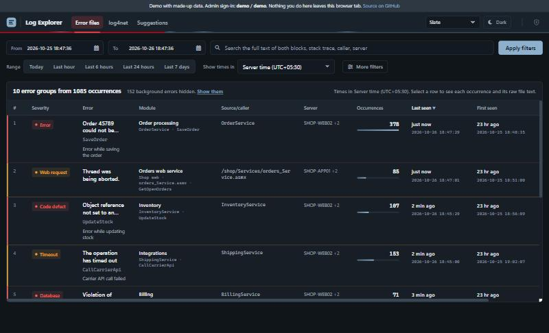
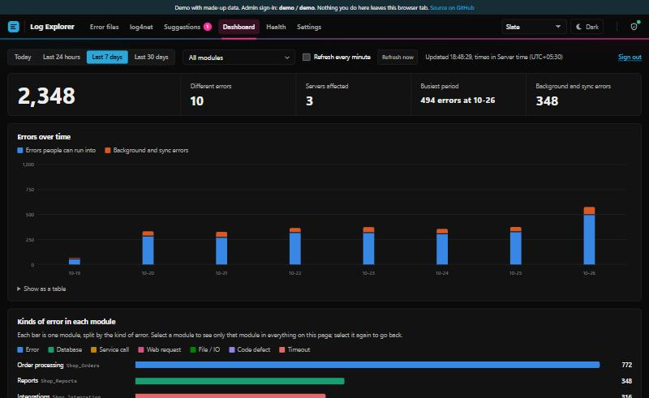
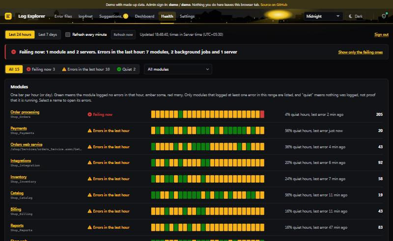

# Log Explorer

A fast, readable web viewer for the error logs of .NET applications on Windows/IIS. It reads **one-exception-per-file error logs** and **log4net** text logs straight from disk, groups repeated errors, and gives admins a dashboard, a health page and a suggestion box. No database and nothing to install on the client.

**[Try the live demo](https://onkar-mane.github.io/log-explorer/)**: it runs in your browser on made-up data. Admin sign-in: `demo` / `demo`.



| Dashboard | Health |
|---|---|
|  |  |

## What it does

- **Error files**: every file in the chosen time range is read (with honest notices when a limit is reached), and repeated errors are grouped. The grouping ignores numbers, ids and dates, so "Order 48213 failed" and "Order 51207 failed" count as one problem. You get the severity, how often it happened, the first and last time, the servers, and the full raw text of each occurrence.
- **Readable names**: `/shop/Services/orders_Service.asmx/GetOpenOrders` is shown as **Orders web service**, with the file and method underneath. Errors thrown inside .NET (`mscorlib`, `System.Data.OracleClient`) are named after the first line of your own code in the stack trace. You can add your own names in `web.config`.
- **Filters and search**: search the full text of every file, plus server, error type, module (multi-select), source, custom message and async-only filters, with paging and sorting. Background/sync jobs that you list are tagged and hidden by default (never skipped).
- **Time zones**: files are in server time; show them in server time, your browser's zone or any listed zone.
- **log4net**: a stream view with level chips, channel and logger filters, Follow mode and CSV export.
- **Admins** (two roles):
  - **Dashboard**: errors over time, kinds of error per module, most frequent errors, background jobs.
  - **Health**: a status page per module, job and server, with status filters; click a bar to open exactly that hour's errors.
  - **Settings** (super admin): look and feel, background rules, log folders, read limits, suggestion limits, user accounts and an activity log. Saved to `App_Data`; `web.config` is never rewritten.
- **Suggestions**: people send ideas and vote; admins reply, set a status, hide or delete. Sending can require a user account (open sign-up), and each suggestion records the network address and a browser id, visible only to admins.
- **Four styles**: Slate (default), Cerulean & rose, Web (spiders) and Midnight (searchlight and bats). Each has dark and light modes and respects "reduce motion".
- **Works offline**: all fonts, icons and scripts are in the repo; nothing is loaded from the internet.

## The error-file format

One exception per file, named by its time, `MM-dd-yyyy-HH_mm_ss_ffff.log`, usually UTF-16 without a byte-order mark (UTF-8 also works). A file has one or more blocks, each starting with `TimeStamp:`:

```text
TimeStamp: 2026-10-26T10:15:02
Message: Order 48213 could not be saved: customer credit limit exceeded
Server Name: SHOP-WEB01
Error Type: System.InvalidOperationException
Error Module: Shop_Orders
Error Method: SaveOrder
Notes: at Shop_Orders.OrderBAL.SaveOrder(Order order) at Shop_Orders.OrderService.Save(OrderDto dto)
TimeStamp: 2026-10-26T10:15:02
Message: OrderService Browser Settings values for id: SiteID: 3
Server Name: SHOP-WEB01
Custom Message: Error while saving the order
Error Module: Shop_Orders
Error Method: SaveOrder
Line Number: 0
```

Block 1 is the exception. Block 2 (optional) is what the application passed to its logger: the page or class, a custom message and its own module name. Both are merged into one entry. log4net files use the pattern `%date [%thread] %level %logger - %message%newline`.

## Requirements

- Windows Server or Windows with **IIS** and **.NET Framework 4.x** (ASP.NET 4). No database.
- The site's application-pool account needs **read** access to the log folders and **write** access to `App_Data`.

## Install

1. Copy the repository to the server, for example `D:\Sites\LogExplorer`. The folders `tools`, `docs`, `src` and `node_modules` are not needed on the server.
2. Copy `web.config.example` to `web.config` and set at least:
   - `LogDirectoryPath`: the error-file folder. Several folders are separated by `;`, optionally as `Label=Path`.
   - `Log4NetDirectoryPath`: the log4net folder.
   - `SuperAdminPassword` and `AdminPassword`: strong passwords, or `sha256:<hex>`. Empty switches that sign-in off.
3. In IIS, add a website (or application) pointing at the folder, with an application pool on **.NET CLR v4.0**.
4. Give the pool account write access to `App_Data`, for example: `icacls App_Data /grant "IIS AppPool\LogExplorer":(OI)(CI)M`.
5. Open the site and sign in with the shield button at the top right.

### Try it with sample logs

```bash
node tools/make-sample-logs.js D:\Logs\Sample 7
```

This writes about 2,700 made-up error files and three log4net files for the last 7 days. Point `LogDirectoryPath` at `D:\Logs\Sample\errors` and `Log4NetDirectoryPath` at `D:\Logs\Sample\log4net`.

## Configuration

Everything is in `web.config` (see the comments in `web.config.example`). The most useful settings:

| Key | Default | What it does |
|---|---|---|
| `MaxFiles` | 20000 | Newest files read for the list when nobody is searching (a notice says when the limit is hit) |
| `MaxSearchFiles` | 30000 | Newest files whose full text is searched |
| `DashboardMaxFiles` | 100000 | Files the Dashboard and Health add up |
| `MaxCachedFiles` / `CacheHours` | 150000 / 12 | Parsed files kept in memory (about 0.6 KB each) |
| `ServerUtcOffsetMinutes` | (empty) | Clock offset of the log servers, if it differs from this web server |
| `BackgroundLogPageNames` / `BackgroundLogModules` | | Jobs whose errors are tagged as background and hidden by default |
| `HealthCriticalPerHour` | 20 | Errors per hour that paint a Health bar red |
| `ModuleDisplayNames` | | Your readable names, e.g. `Shop_Orders*,OrderService=Order processing;Shop_Sync*=Nightly sync` |
| `SuggestionsEnabled`, `SuggestionsNeedSignIn`, `UserSignUpOpen`, `UserPasswordMinLength` | true, true, true, 6 | The Suggestions tab and user accounts |

The super admin can override most of these on the Settings page. They are saved in `App_Data/ui-settings.json`.

## Security notes

- This is meant for an **internal network**. Put it behind HTTPS if anything other than your office network can reach it.
- **Admin passwords** live in `web.config`. Use `sha256:<hex>` to keep them unreadable. Five wrong attempts lock a computer out for five minutes.
- **User accounts** (Suggestions) are stored in `App_Data/users.dat`:
  - The file is encrypted with Windows DPAPI (the server's machine key), and passwords are kept only as salted PBKDF2 hashes.
  - Moving the site to another server means people sign up again.
- **IIS never serves `App_Data`.** You can still restrict it further with NTFS permissions.
- **Every admin change** is written to `App_Data/admin-audit.log`.

## The demo (GitHub Pages)

`docs/` holds a static copy of the page with a small in-browser stand-in for the server (`tools/demo-api.js`) and made-up data (`tools/sample-data.js`). Rebuild it after changing `Default.aspx`:

```bash
node tools/build-demo.js
```

GitHub Pages serves it from the `docs` folder of the `main` branch.

## Development

The page is one `Default.aspx` with its code-behind; the logic lives in `App_Code` (compiled by ASP.NET on first request, C# 5). Utility CSS is built with Tailwind:

```bash
npm install
npm run build:css
```

## Licence

[MIT](LICENSE)
